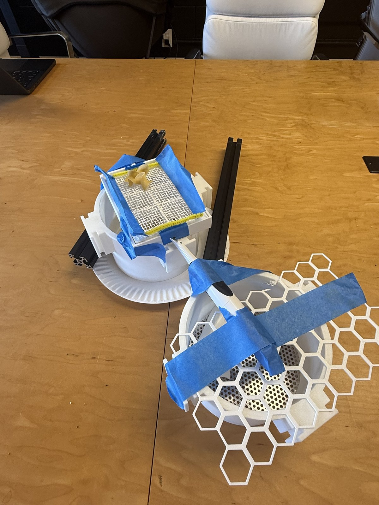
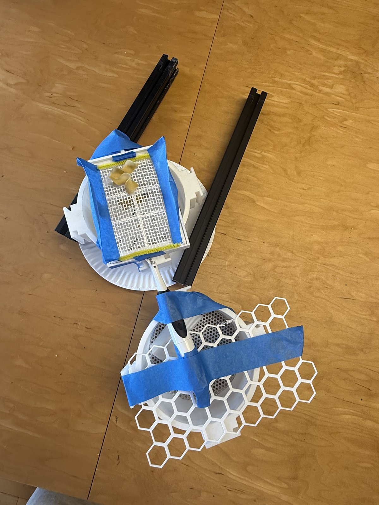
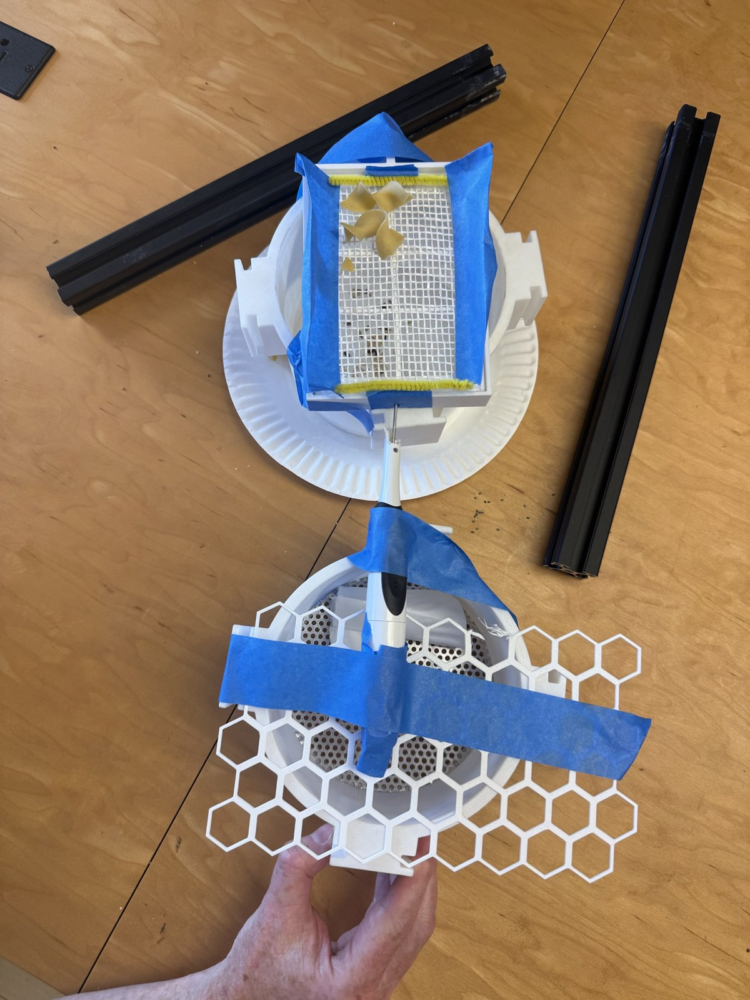

# BugPicker Lane Line — vibration singulation for BioKEA's sample-prep line

**Physical AI for Science · Impact Lab · Oct 17, 2026 · Track A (BioKEA)**

> Let physics do the singulation. The robot only fixes the exceptions.



## The problem (from Track A, slide 11)

BioKEA's prototype line turns a bag of preserved insects into barcodes: BugSorter (size sort) → BugDisperser → **BugPicker** (vision-guided suction pick-and-place into a 96-well plate) → enzyme dispenser → incubator. The challenge: *make sample prep robust* — a sieve that works on real preserved samples run after run, or any other module, or the software layer (MCP server / provenance).

Today's stand-in for bugs is a pantry size ladder: chia (~1 mm), couscous (~2 mm), rice (~6 mm), wild rice (~10 mm), broken noodles (10–20 mm), whole noodles (~30 mm).

The weak link is the BugPicker. 96 vision-guided picks per plate, every pick a failure point (clumps, legs, wet specimens, mis-grasps). The kit's open question on slide 14: *what motion clears a blinded screen, and how does the stack know it is done?*

## Our answer

Hand singulation to **vibration + geometry**, not to the arm:

1. **Vibrate the sieve stack** with a cheap sonic motor (an electric toothbrush, ~$10) acting as a pushrod on a hanging sieve tray. Fines fall through, the retained fraction *walks* directionally across the screen — this is a vibratory feeder built from the kit's own parts.
2. **Stack the kit's hex honeycomb** on the screen. Each cell holds exactly one specimen of the fraction it is sized for; extras walk off the edge. Pockets self-load — no vision needed to *locate* anything.
3. **Camera counts, robot fixes exceptions.** A webcam over the honeycomb verifies one-per-cell. The arm only touches doubles and empties: ~96 moves per plate drops to under 20.
4. **Expose it as an MCP server** (`inspect / verify / dispatch / trace`) so an agent runs the protocol and every run writes its own provenance record — the stack "knows it is done" because the count says so.

```
 bag → BugSorter (3 screens) → [vibrating tray + hex honeycomb] → camera count → arm fixes exceptions → 96-well
                                   ^ this repo                      ^ next weekend
```

## What we built today (kit parts + under $15)

| Part | Source |
|---|---|
| Printed sieve tray + 2 mm mesh, square tray frame | BioKEA kit |
| Round sieve ring + perforated plate | BioKEA kit |
| Hex honeycomb grid | BioKEA kit |
| T-slot extrusion (frame / uprights) | BioKEA kit |
| Battery sonic toothbrush (vibration source, pushrod) | owned, ~$10 |
| Pipe cleaners (soft suspension), painter's tape, paper plate (catch) | pantry |

Mounting that worked: toothbrush **body fixed** to a stationary upright; the vibrating **shaft tip pressed into a hole in the hanging tray frame** (crank/pushrod). Rigidly taping the body to the tray does not work — the body barely moves, the head does.




## Results (honest)

| Step | Status |
|---|---|
| Vibration sieves chia/sesame through 2 mm mesh, retains rice | ✅ works |
| Retained fraction walks directionally to one edge | ✅ works (diagonal — shaft alignment needs tuning) |
| Honeycomb one-per-cell loading | 🔧 parts on bench, untested with motor |
| Camera count + MCP server | 📝 designed, not wired |

Demo video: [`media/demo-shake.mp4`](media/demo-shake.mp4)

## Why this beats more picking

| | Vision pick-and-place (today) | Vibration + honeycomb (this) |
|---|---|---|
| Robot moves / plate | 96 | < 20 (exceptions only) |
| Needs vision to locate | every specimen | no — only to count |
| Clumps | mis-grasp | agitation detangles before loading |
| Added hardware | — | ~$10 motor + webcam |

## Next weekend (ReBot arms arrive)

- STLs to Sean tonight: lane plate, honeycomb variants per sieve fraction (2 / 6 / 10 mm cells), leaf-spring suspension to replace pipe cleaners.
- Test wet with ethanol-preserved specimens.
- Wire the webcam count into the MCP server (`inspect / verify / dispatch / trace`); a run declares itself done.
- BOM ask: sonic motor, USB camera, LED panel.

See [`docs/design.md`](docs/design.md) for dimensions, the pushrod mount, and the MCP tool schema.

## Team

Cici Mao · [team members] — built at Studio 45, SF, with BioKEA's kit. Thanks Sean, Chris, Michelle, Austin.
